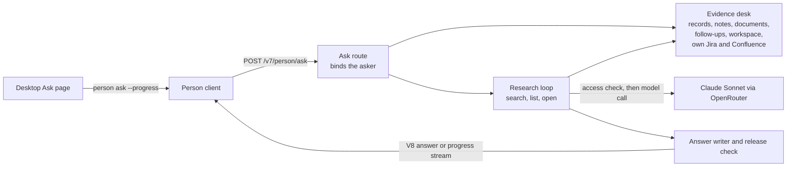

# Ask and research

**Status:** Current. Verified against `origin/main` at
`aa92138e4a7d8386b2ff51a95c7d2f82e86236be` (2026-10-30); updated 2026-11-08
for the lean-down (sweeps and per-note search hints retired).

Ask answers a person's question from everything that person can read in ECHO
and in their own connected tools. The same research engine runs impact checks
in the background. It is the largest server subsystem: about two thirds of
`packages/organization-authority-kernel` is answer composition. This page maps
the route, the evidence a question can reach, the research loop and its
safeguards. Decisions behind each part are linked inline; the
[system overview](overview.md) shows where Ask sits in the whole system.

## Shape of one Ask

## Route and contract

- **One route:** `POST /v7/person/ask`, answering the V8 answer shape. Older
  answer routes return 404
  ([ADR-0048](../decisions/ADR-0048-retire-older-person-routes.md)).
- **Request headers:** `x-echo-ask-progress: 3` streams progress as server-sent
  events ([ADR-0039](../decisions/ADR-0039-ask-progress-names-after-the-access-check.md));
  `x-echo-client-now` and `x-echo-time-zone` anchor dates. Every answer is
  arranged by the writer from a catalog of seven blocks and released in them
  ([ADR-0051](../decisions/ADR-0051-ask-answer-layout-v2.md)); no header asks
  for it, and `x-echo-answer-layout`, which older clients send, is not read. A follow-up carries
  the previous turn ([ADR-0047](../decisions/ADR-0047-ask-timeline.md)).
- **Scopes:** the whole organization, or one project. The `mine` scope is
  retired; a request that names it is refused.
- **Contracts:** `packages/organization-api` (`person-answer-v8.ts` and the
  progress, receipt and layout contracts).

## Where the evidence comes from

The route (`composition/person-live-answer-route-v1.ts`, with scope rules in
`person-answer-v3-route.ts`) binds one evidence desk to the asker for the
length of the request
([ADR-0042](../decisions/ADR-0042-research-tool-contract.md)). Every source
declares what it can search, list and open; the loop reads each source by that
declaration.

| Source | Code | Notes |
| --- | --- | --- |
| Approved records | `composition/person-record-search-route.ts` on the pinned search generation | Only what the asker's policies admit |
| Notes, documents and originals | `person-evidence-desk-v1.ts`, original-context retrieval | The asker's own unapproved meetings included |
| Follow-ups | `person-follow-ups-evidence-v1.ts` | Exactly as Home shows them ([ADR-0040](../decisions/ADR-0040-follow-ups-as-ask-evidence.md)) |
| Workspace | `person-workspace-evidence-v1.ts` | The asker's projects, the people in their organization, and their tools |
| Jira and Confluence | `person-live-connector-registry-v1.ts` with the provider readers | Read live with the asker's own connection; bodies stay in request memory |

A complete list is evidence of which items exist
([ADR-0041](../decisions/ADR-0041-complete-lists-as-ask-evidence.md)). Ask never
reads Slack.

## The research loop

The engine lives in `packages/organization-authority-kernel/src/answer-composition/`:

| Module | Role |
| --- | --- |
| `agentic-ask-v1.ts` | Runs one Ask: budget, deadline, research, writing, audit |
| `agentic-research-loop-v1.ts` | Rounds of search, list and open, steered by the model |
| `agentic-ask-v1-model-protocol.ts` | Prompts and JSON schemas for the model |
| `agentic-model-gate-v1.ts` | The access check before every model call |
| `agentic-list-evidence-v1.ts` | Complete lists as evidence |
| `renderers/ask-renderer-v1.ts`, `ask-layout-v2.ts` | The written answer and its blocks |
| `agentic-ask-progress-recorder-v1.ts` | Progress steps and the receipt of what was looked through ([ADR-0043](../decisions/ADR-0043-ask-receipt-counts-what-research-looked-through.md)) |
| `agentic-release-v1.ts` | The release step: final access check, audit, second check |

Budgets (`agentic-research-v1.ts`):

| Profile | Rounds | Model calls | Deadline |
| --- | --- | --- | --- |
| Live Ask | 10 | 24 | 90 s |
| Background (impact checks) | 20 | 48 | 300 s |

## Safeguards

- **Access before every model call.** Every research or writer call passes
  the model gate. It revalidates the asker's access, re-reading only evidence
  that is new since the last check
  ([ADR-0038](../decisions/ADR-0038-incremental-access-check-before-model-calls.md)),
  enforces the request's call and time budget, records the call for the audit,
  and allows one repair of a malformed reply.
- **Names after the check.** Progress names a source only after the access
  check passed for it.
- **Release step.** Before a result leaves, a final access check runs, one
  content-free audit record is written for the whole request, and access is
  checked once more after that write.
- **Content-free audits.** The audit keeps coordinates and digests, never
  content, in `authority_person_read_decision_audit_v2`.
- **One model limiter.** `composition/model-call-limiter-v1.ts` allows six model
  calls at once, four of them background, and pauses after a rate-limit reply.

## Models

Ask and research call `anthropic/claude-sonnet-5.5` through OpenRouter
(`providers/openrouter`). Saving a note makes no model call: the per-note
search hints were retired on 2026-11-08. Meeting extraction uses
`anthropic/claude-sonnet-4.6`, whose configuration digest is committed when a
source is admitted, so changing it needs fresh state. On staging, the connector
profile can select the Claude Agent SDK research engine, and one member can use
their own Claude account; that code lives in
`providers/openrouter/src/claude-research/`.

The native research finish contract distinguishes a finished investigation from
finding an answer. Closed Ask needs, including `not_found`, pass the existing
observed-read and coverage checks before research is considered complete, even
when the driver supplied `completed=false`. Open needs and interrupted reads
remain incomplete. For Ask requests to change data or send messages, the driver
can set `unsupported_action=true`: an action-only request has no factual parts
and needs no search; mixed requests still validate their factual needs normally.
Every Ask answer part with a typed gap, the research evaluation's included,
carries `gap_details` (the Authority no longer reads the old
`x-echo-ask-gap-details` opt-in). The renderer supplies them separately from the diagnostic `gap`:
unsupported action, unfinished research, and a bounded not-found explanation.
The desktop and Copy use only these actionable reasons; coverage and formatting
diagnostics stay hidden. The response stays partial for unsupported requests,
and internal researcher notes are never published. Background task goals do not
accept this Ask capability signal. Completion checks prove observed reads and
coverage, not query relevance or command intent; those remain model judgments
covered by negative evaluation cases and live rehearsal. A list selection
becomes actionable absence only after complete, verified coverage of the
selection facts; empty subsets of incomplete or unchecked lists do not qualify.

## Side routes

| Route | Purpose | Caller |
| --- | --- | --- |
| `POST /v1/person/ask/check` | Content-free check that an old turn's sources are still readable | Desktop, when an old turn opens |
| `POST /v2/person/ask/source` | Open one cited source | Desktop |
| `POST /v1/person/research-eval/start`, `/read` | Staging evaluation runs | `npm run eval:research-loop` |

## Evaluation

`tools/evals/research-loop` (`npm run eval:research-loop`) runs scripted
questions against a staging Authority; `ask-follow-up` and `ask-blocks` (the
Ask writer gate) under `tools/evals/` check the engine offline.
Their unit tests run in CI's tail leg.

A research run's exact prompts, replies and tool calls are read from its
[staging LangSmith trace](../../deploy/organization-authority/README.md#langsmith-staging-tracing).
The one-use diagnostic captures (`POST /v1/person/diagnostics`) and the
research-loop `trace` command that read them were retired on 2026-11-09; the
path answers 404 and stays reserved.

See also: [impact checks and open items](impact-checks-and-open-items.md),
[global and project Ask](../features/global-project-ask-v1.md),
[permissions](../components/permissions.md).
