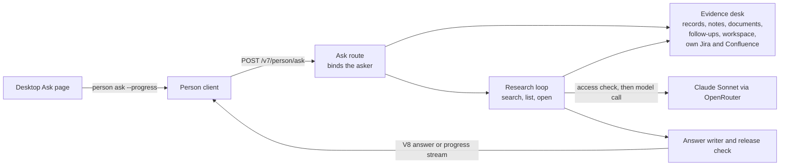

# Ask and research

**Status:** Current. Verified against `origin/main` at
`aa92138e4a7d8386b2ff51a95c7d2f82e86236be` (2026-10-30).

Ask answers a person's question from everything that person can read in ECHO
and in their own connected tools. The same research engine runs impact checks
in the background. It is the largest server subsystem: about two thirds of
`packages/organization-authority-kernel` is answer composition. This page maps
the route, the evidence a question can reach, the research loop and its
safeguards. Decisions behind each part are linked inline; the
[system overview](overview.md) shows where Ask sits in the whole system.

## Shape of one Ask

## Route and contract

- **One route:** `POST /v7/person/ask`, answering the V8 answer shape. Older
  answer routes return 404
  ([ADR-0048](../decisions/ADR-0048-retire-older-person-routes.md)).
- **Request headers:** `x-echo-ask-progress: 3` streams progress as server-sent
  events ([ADR-0039](../decisions/ADR-0039-ask-progress-names-after-the-access-check.md));
  `x-echo-answer-layout: 1` asks for a laid-out answer
  ([ADR-0045](../decisions/ADR-0045-ask-answer-layout.md));
  `x-echo-client-now` and `x-echo-time-zone` anchor dates. A follow-up carries
  the previous turn ([ADR-0047](../decisions/ADR-0047-ask-timeline.md)).
- **Scopes:** the whole organization, or one project. The `mine` scope is
  retired; a request that names it is refused.
- **Contracts:** `packages/organization-api` (`person-answer-v8.ts` and the
  progress, receipt and layout contracts).

## Where the evidence comes from

The route (`composition/person-live-answer-route-v1.ts`, with scope rules in
`person-answer-v3-route.ts`) binds one evidence desk to the asker for the
length of the request
([ADR-0042](../decisions/ADR-0042-research-tool-contract.md)). Every source
declares what it can search, list and open; the loop reads each source by that
declaration.

| Source | Code | Notes |
| --- | --- | --- |
| Approved records | `composition/person-record-search-route.ts` on the pinned search generation | Only what the asker's policies admit |
| Notes, documents and originals | `person-evidence-desk-v1.ts`, original-context retrieval | The asker's own unapproved meetings included |
| Follow-ups | `person-follow-ups-evidence-v1.ts` | Exactly as Home shows them ([ADR-0040](../decisions/ADR-0040-follow-ups-as-ask-evidence.md)) |
| Workspace | `person-workspace-evidence-v1.ts` | The asker's projects, the people in their organization, and their tools |
| Jira and Confluence | `person-live-connector-registry-v1.ts` with the provider readers | Read live with the asker's own connection; bodies stay in request memory |

A complete list is evidence of which items exist
([ADR-0041](../decisions/ADR-0041-complete-lists-as-ask-evidence.md)). Ask never
reads Slack.

## The research loop

The engine lives in `packages/organization-authority-kernel/src/answer-composition/`:

| Module | Role |
| --- | --- |
| `agentic-ask-v1.ts` | Runs one Ask: budget, deadline, research, writing, audit |
| `agentic-research-loop-v1.ts` | Rounds of search, list and open, steered by the model |
| `agentic-ask-v1-model-protocol.ts` | Prompts and JSON schemas for the model |
| `agentic-model-gate-v1.ts` | The access check before every model call |
| `agentic-list-evidence-v1.ts` | Complete lists as evidence |
| `renderers/ask-renderer-v1.ts`, `ask-layout-v1.ts` | The written answer and its layout |
| `agentic-ask-progress-recorder-v1.ts` | Progress steps and the receipt of what was looked through ([ADR-0043](../decisions/ADR-0043-ask-receipt-counts-what-research-looked-through.md)) |
| `agentic-release-v1.ts` | The release step: final access check, audit, second check |

Budgets (`agentic-research-v1.ts`):

| Profile | Rounds | Model calls | Deadline |
| --- | --- | --- | --- |
| Live Ask | 10 | 24 | 90 s |
| Background (impact checks, sweeps) | 20 | 48 | 300 s |

## Safeguards

- **Access before every model call.** Every research or writer call passes
  the model gate. It revalidates the asker's access, re-reading only evidence
  that is new since the last check
  ([ADR-0038](../decisions/ADR-0038-incremental-access-check-before-model-calls.md)),
  enforces the request's call and time budget, records the call for the audit,
  and allows one repair of a malformed reply.
- **Names after the check.** Progress names a source only after the access
  check passed for it.
- **Release step.** Before a result leaves, a final access check runs, one
  content-free audit record is written for the whole request, and access is
  checked once more after that write.
- **Content-free audits.** The audit keeps coordinates and digests, never
  content, in `authority_person_read_decision_audit_v2`.
- **One model limiter.** `composition/model-call-limiter-v1.ts` allows six model
  calls at once, four of them background, and pauses after a rate-limit reply.

## Models

Ask, research and search hints call `anthropic/claude-sonnet-5.5` through
OpenRouter (`providers/openrouter`). Meeting extraction uses
`anthropic/claude-sonnet-4.6`, whose configuration digest is committed when a
source is admitted, so changing it needs fresh state. On staging, the connector
profile can select the Claude Agent SDK research engine, and one member can use
their own Claude account; that code lives in
`providers/openrouter/src/claude-research/`.

## Side routes

| Route | Purpose | Caller |
| --- | --- | --- |
| `POST /v1/person/ask/check` | Content-free check that an old turn's sources are still readable | Desktop, when an old turn opens |
| `POST /v2/person/ask/source` | Open one cited source | Desktop |
| `POST /v3/person/evidence/search` | The evidence desk's search, directly | The research-loop eval |
| `POST /v1/person/diagnostics` | One-use diagnostic capture | Research-loop traces |
| `POST /v1/person/research-eval/start`, `/read` | Staging evaluation runs | `npm run eval:research-loop` |

## Evaluation

`tools/evals/research-loop` (`npm run eval:research-loop`) runs scripted
questions against a staging Authority; `agentic-ask`, `ask-follow-up` and
`ask-wording` under `tools/evals/` check the engine offline. Their unit tests
run in CI's tail leg.

See also: [impact checks and open items](impact-checks-and-open-items.md),
[global and project Ask](../features/global-project-ask-v1.md),
[permissions](../components/permissions.md).
