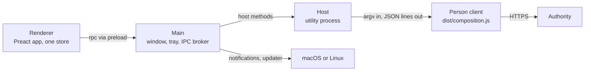

# Desktop app

**Status:** Current. Verified against `origin/main` at
`aa92138e4a7d8386b2ff51a95c7d2f82e86236be` (2026-10-30).

The desktop app (`product/echo-desktop`) is how team members use ECHO. It is an
Electron app with its own package and `node_modules`; it is not a root
workspace. It contains no Authority logic: every read and write goes through
the built Person client, which it runs in-process. This page maps its
processes, call path, local state and background work. The
[system overview](overview.md) places it in the whole system; the
[desktop README](../../product/echo-desktop/README.md) covers building,
packaging and running it.

## Processes

| Process | Code | Responsibility |
| --- | --- | --- |
| Main | `src/main/main.ts`, `src/main/update.ts` | Window, tray menu, global shortcuts, the single-instance lock, the `app://echo` page protocol with its content security policy, the IPC broker, file handles, system notifications, the host supervisor, the updater, `desktop.log`. Main never reads the session. |
| Host | `src/host/host.ts`, `cli.ts`, `views.ts`, `ask.ts`, `timeline.ts`, `session.ts` | An Electron utility process and the only process holding a token. It imports the Person client's `dist/composition.js` and `dist/session-store.js` and runs `runPersonClientCli(argv, deps)`, exactly as `person …` would, then turns the last JSON line into a token-free view model through `organization-api` validators. |
| Preload | `src/preload/preload.ts` | Exposes `window.echo = { rpc, on, dropFile }` through `contextBridge`. The renderer is sandboxed, context-isolated and has no Node access. |
| Renderer | `src/renderer/` | One Preact app (`main.tsx`), one store (`store.ts`), screens in `screens/`, and pure rule modules such as `answer`, `timeline`, `needs`, `freshness` and `format`. |
| Shared | `src/shared/protocol.ts`, `query.ts`, `folders.ts` | The whole IPC contract (host methods, main methods, events and their guards) and rules both sides apply. |

## The call path

1. The renderer calls `rpc(method, params)`.
2. Main's broker accepts it only from the app's own main frame, only as plain
   JSON up to 64 KiB (256 KiB for `timeline.put`), and only for an allowlisted
   method. Main answers its own methods (dialogs, clipboard, menus, notices,
   updates) and forwards host methods, swapping file handles for paths on the
   way. Dropped files use a separate channel with the path read from a real
   `File`.
3. The host refreshes the token first when it would expire during the call,
   reads `person status` before and after the command, and refuses a result
   that belongs to another account.
4. The Person client talks HTTPS to the Authority, for example
   `POST /v7/person/ask`, `POST /v1/person/runs`, `GET /v1/person/changes` and
   `GET /v2/person/projects`.
5. Host notices (`signin.phase`, `ask.progress`, `open-external`) return to
   main, which relays them to the renderer or opens HTTPS links itself.

In a packaged app the Person client comes from
`resources/person-client/package/dist/`, extracted from the release's exact
client tarball. In development it is `src/product/person-client/dist` in the
checkout. The renderer may import `organization-api` for types only, because
the package pulls `node:crypto`; where the page needs an API rule it keeps a
copy that a unit test proves equivalent.

## Screens

| Screen | Code | What it is for |
| --- | --- | --- |
| Home | `screens/home.tsx`, `screens/altitude.tsx` | What needs you, grouped by kind, then your projects; zoom into a project or a person. Home always opens at its top. |
| Decision | `screens/decision.tsx`, `card.tsx`, `impact-card.tsx` | Approve a meeting, route each item, see its impact checks |
| Ask | `screens/ask.tsx` | Question bar with suggestions, the thread, the source pane |
| Project | `screens/project.tsx`, `items.tsx`, `project-settings.tsx`, `people.tsx` | The project feed, settings, Tools mappings and members |
| Only me | `screens/only-me.tsx`, `only-me-row.tsx` | Items locked to you |
| Follow-ups | `screens/follow-ups.tsx` | Follow-up lists and the item page |
| Reader | `screens/reader.tsx` | Any item by reference |
| Capture | `screens/compose.tsx`, `project-picker.tsx`, `new-project.tsx` | Notes, documents and new projects |
| Tools | `screens/tools.tsx`, `meetings.tsx`, `paste-meeting.tsx` | Personal connections, Granola meetings, pasting a meeting |
| Organization | `screens/organization.tsx` | People and invitations, for owners |
| Sign-in | `screens/signin.tsx`, `account.tsx` | Invitation or returning sign-in, sign-out |

## Background work

- **Change check and notifications**
  ([ADR-0036](../decisions/ADR-0036-person-change-check.md)). The renderer's
  `freshness.ts` runs `changes.read` at sign-in, on return to the window, when
  a page opens (at most every 10 s), on wake, and at the pace the Authority
  sets. It re-reads only the areas that moved, decides what deserves a
  notification and asks main to show it. A click sends `notice.open` and brings
  the window forward.
- **Impact checks.** The store's runs driver starts, retries, polls and sweeps
  impact checks through `person runs` while a person is signed in, on any
  page. Nothing runs once the app quits; see
  [impact checks and open items](impact-checks-and-open-items.md).
- **Ask** ([ADR-0039](../decisions/ADR-0039-ask-progress-names-after-the-access-check.md),
  [ADR-0045](../decisions/ADR-0045-ask-answer-layout.md),
  [ADR-0047](../decisions/ADR-0047-ask-timeline.md)). `ask.run` builds
  `person ask --question … --progress --expected-membership-id …
  --expected-authority …`, forwards each progress line tagged with the page's
  cancel id, renders the laid-out answer and keeps each turn with
  `timeline.put`. Opening an old turn runs `ask.check`, a content-free check
  that its sources are still readable.

## Updates

Only release packages update themselves
([ADR-0035](../decisions/ADR-0035-desktop-updates-from-the-signed-feed.md),
[ADR-0050](../decisions/ADR-0050-update-floor-only-rises.md)). Main loads the
updater from the embedded Person client, checks 10 s after start and every 10
minutes (the client's own gate contacts the feed at most hourly), and shows the
result in the sidebar's update row. Each launch re-offers the release
identity's bootstrap, so the floor only rises and a different publisher shows
"Updates are off". Installing is refused while a save or project change is
unresolved.

- **macOS:** stages and verifies the signed `ECHO.app` on the same volume,
  quits, and a detached helper swaps the bundles.
- **Linux:** stages the `.deb` and feed; `pkexec` runs a root helper that
  verifies again, then reinstalls with `apt-get`.

## Local state

| What | Where |
| --- | --- |
| Person session | `~/.local/share/echo-brain/person/`, owned by the Person client |
| Ask timeline | `<person dir>/ask-timeline-v1/<digest>.json`, one file per account, at most 200 turns and 90 days, deleted at sign-out |
| Updater state | `<appData>/ECHO/desktop/updater/` |
| Chromium data and log | `<appData>/ECHO/chromium`; `<userData>/logs/desktop.log` (codes only, rotated at 1 MiB) |
| Renderer conveniences | Three `localStorage` keys: sidebar open, last Authority, projects seen |

## Tests

Unit tests (`test/unit`, Vitest) cover the pure rules and the host. The
Playwright suite (`test/e2e`) launches the real app against a stateful fake
Authority (`test/fixtures/authority.ts`). The separate `desktop-app` CI job runs
typecheck, unit tests, Playwright, packaging with its release leak check, and a
packaged smoke test on macOS arm64 and Linux x64; the root `npm run check`
does not reach the desktop.

See also: [Desktop app component](../components/desktop-app.md),
[Person client architecture](person-client-architecture.md).
