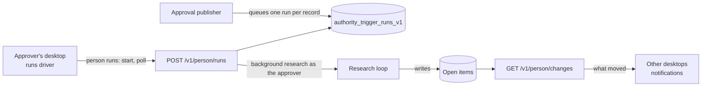

# Impact checks and open items

**Status:** Current. Verified against `origin/main` at
`aa92138e4a7d8386b2ff51a95c7d2f82e86236be` (2026-10-30).

When a meeting's items are approved, ECHO checks what else they affect and
writes follow-ups ("open items") for the people involved. This page maps how a
check is queued, who runs it, what it writes and how desktops learn about it.
The research it runs is described in [Ask and research](ask-and-research.md);
the [system overview](overview.md) places it in the whole system.

## Lifecycle of one check

1. **Queue.** When the publisher appends a record, an after-record hook queues
   one impact check for it in `authority_trigger_runs_v1`, in the same
   transaction ([ADR-0032](../decisions/ADR-0032-stored-trigger-runs.md)).
2. **Start.** A client of the approver starts queued checks with
   `person runs`. In practice that is the desktop's runs driver (in
   `product/echo-desktop/src/renderer/store.ts`): it calls `start`, polls while
   a check is going and runs sweeps, wherever ECHO runs for that person, on any
   page, even closed to the tray. A failed check waits on Home until the person
   retries it. Nothing runs once the app quits, and the server never starts a
   check on its own.
3. **Run.** `composition/person-trigger-runs-v1.ts` runs background research
   as the approver, with the approver's access, at background model priority
   (20 rounds, 48 model calls, 300 s). At most four checks run at once per
   Authority.
4. **Write.** The run stores pointers and judgments, never outside text
   (ADR-0032), and writes open items: one shared row per affected item, seen by
   the decision's audience
   ([ADR-0033](../decisions/ADR-0033-shared-open-items.md)).
5. **Tell.** The change check
   ([ADR-0036](../decisions/ADR-0036-person-change-check.md)) gives each desktop
   fingerprints of its projects, follow-ups and reviews. A desktop re-reads only
   what moved and raises a notification when someone else moves a follow-up or
   adds the person to a project.

## The runs route

`POST /v1/person/runs` carries one operation per request (contracts in
`packages/organization-api`):

| Operation | Purpose |
| --- | --- |
| `list`, `home`, `view` | Read the person's runs and what Home shows |
| `start`, `retry` | Start or retry a queued check |
| `items`, `item` | Read open items by scope (`mine`, `involved`, `run`, `record`, `project`) or one item |
| `send` | Send a check's follow-ups to the people involved |
| `set_state`, `assign` | Mark an item open, done or not relevant; give it an owner |
| `sweep` | Re-check open items for a person, record or project |

`composition/person-open-items-v1.ts` serves the item operations under
`open-items-policy-v1.ts`; `person-sweep-runs-v1.ts` does a sweep's own work.
The kernel holds the trigger definitions and the impact-card and sweep
renderers (`src/answer-composition/`).

## Where it shows

- **Home** groups what needs the person by kind: approve, send, update, retry,
  and checks still going.
- **Follow-ups** lists the follow-ups a person has sent, and each item has its
  own page.
- **Ask** reads follow-ups exactly as Home shows them
  ([ADR-0040](../decisions/ADR-0040-follow-ups-as-ask-evidence.md)).

## Limits

- A check needs a client of the approver to start it; in practice the
  desktop, running and signed in.
- Research runs with the approver's access at the time of the check; the
  model gate re-checks access before every model call.
- Background model calls share the process-wide limiter with Ask (at most four
  of six concurrent calls).

See also: [Desktop app](desktop-app.md),
[Organization Authority component](../components/organization-authority.md).
