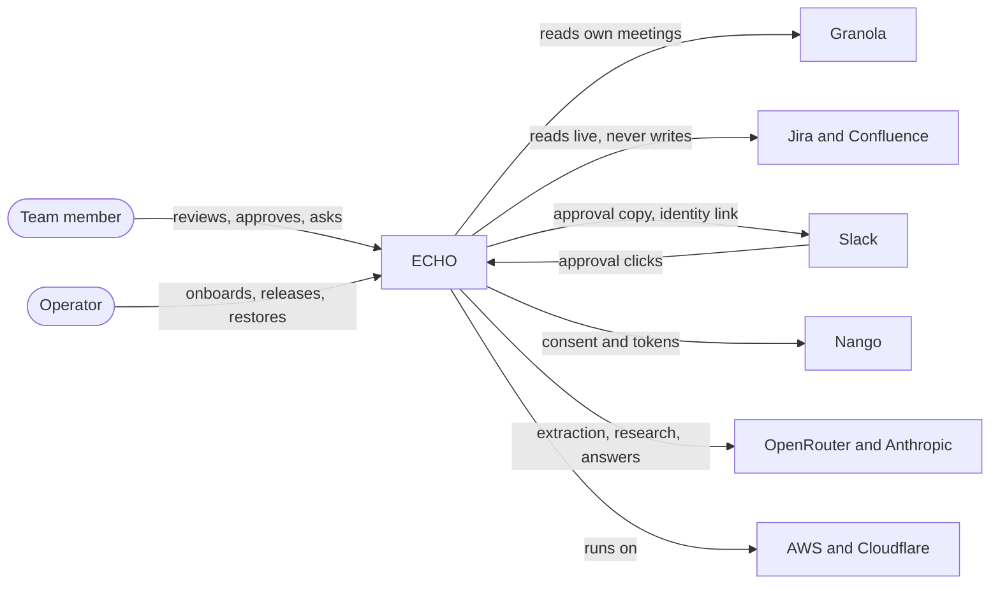
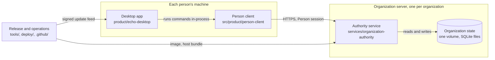
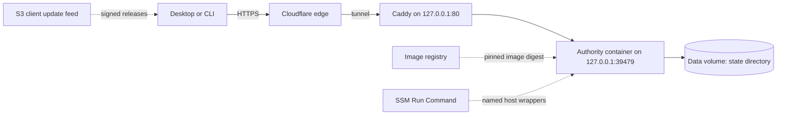

# ECHO system overview

**Status:** Current. Verified against `origin/main` at
`aa92138e4a7d8386b2ff51a95c7d2f82e86236be` (2026-10-30), the first beta
candidate.

ECHO turns each person's meetings and connected work tools into approved,
permission-aware organization records, and lets a team ask questions across
them. This page is the top of the architecture docs. It starts with the whole
system and goes one level deeper per section. Each section ends with the
document that owns the detail; this page restates nothing it does not have to.

| Level | Shows | Section |
| --- | --- | --- |
| 0 | ECHO, the people who use it, and the outside services it touches | [Level 0](#level-0-echo-and-the-world-around-it) |
| 1 | The runtime pieces and the trust boundaries between them | [Level 1](#level-1-runtime-pieces) |
| 2 | The components inside each piece | [Level 2](#level-2-components) |
| 3 | Code paths, tables and contracts | The linked system maps and component pages |

The [key flows](#key-flows) section follows one request across the levels.

## Level 0: ECHO and the world around it

- **Who uses it.** Team members use the desktop app on macOS or Linux. The
  `echo-brain` CLI is the same client without the window. Owners invite people
  and manage the organization from the same app. Operators run the server only
  through the repository's reviewed CLIs and bounded SSM commands
  ([operator playbook](../operations/PB-OPERATIONS-001-authority-operator-lane.md)).
- **What comes in.** Only each person's own sources: their Granola meetings,
  meetings they paste in (`hand-in`), and on staging a synthetic source. There is
  no organization-wide meeting source. Jira and Confluence are read live, with
  the asker's own connection, at question time. Slack is an approval surface
  only; Ask never reads Slack.
- **What goes out.** Signed, append-only organization records, each readable by
  exactly the audience its items were approved to; answers with citations; and
  follow-ups that impact checks find.
- **Rules that shape every level.** ECHO coordinates and never writes to Jira
  or Confluence. A meeting stays private to the person who brought it in until
  each item is approved to a destination
  ([ADR-0046](../decisions/ADR-0046-private-meetings-and-item-routing.md)).
  Every read is authorized again on every request. Each organization gets one
  isolated Authority, operated by ECHO by default
  ([ADR-0008](../decisions/ADR-0008-echo-hosted-authority-by-default.md)).

## Level 1: runtime pieces

| Piece | Code | Owns | Talks to |
| --- | --- | --- | --- |
| Desktop app | `product/echo-desktop` (its own package, not a root workspace) | Windows, tray, notifications, self-update, the device-only Ask timeline | The Person client, in-process; the update feed |
| Person client | `src/product/person-client` (`echo-brain` CLI and library) | The Person session and tokens, retained upload originals, the CLI updater | The Authority over HTTPS |
| Shared contracts | `packages/federation-protocol`, `packages/organization-protocol`, `packages/organization-api` | Canonical JSON, signatures, record envelopes, the Person HTTP shapes | Used on both sides of the boundary |
| Authority service | `services/organization-authority`, composing the other `packages/*` and the server side of `providers/*` | Identity and sessions, meeting intake, extraction, approval, records, search, Ask, impact checks | Granola, Atlassian, Slack, Nango, OpenRouter, Anthropic |
| Organization state | One state directory on one persistent volume | Six SQLite roles, provider sidecars, signing keys, secrets | Opened only by the Authority |
| Release and operations | `tools/`, `deploy/`, `.github/workflows/` | Builds, the AWS staging slot, the client update feed, CI | AWS, only through reviewed CLIs |

Trust boundaries:

- On the desktop, only the host process holds a token. The main process never
  reads the session, and the renderer runs sandboxed with no Node access.
- The Person client is the Authority's only API client. The other callers are
  the browser during sign-in (the OIDC callback and the Slack identity-link
  callback), Slack's signed interaction posts, host scripts that read
  `/v1/authority-descriptor`, and the operator's canary socket.
- The Authority listens on loopback only, behind Caddy and a Cloudflare
  tunnel.
- The Person artifacts carry no Authority code, server provider or SQLite.
  Architecture tests and the boundary gate enforce this
  ([workspace boundaries](organization-workspace-boundaries.md)).

## Level 2: components

### Authority service

The service starts as one process: `serve` →
`composition/organization-authority-service-cli.ts` → the composition root →
`organization-authority-runtime.ts` → the service lifecycle (one worker, one
writer gate) → the API runtime → the HTTP server. Opening the runtime never
migrates: a changed baseline means fresh state.

| Component | Main code | Responsibility |
| --- | --- | --- |
| HTTP edge | `src/presentation/organization-authority-http-server.ts` | Routes, request limits, the Ask progress stream; never opens SQLite |
| Identity and sessions | `src/application/person-identity-sessions.ts`, `adapters/oidc/`, kernel `domain/person-session-rules.ts` | Google OIDC sign-in, rotating sessions (12 h access, re-sign-in after 7 days), membership and revocation on every request |
| Meeting intake | `composition/person-meeting-runtime-v1.ts` | Up to three lanes over personal sources: Granola, pasted meetings, the staging synthetic source |
| Extraction | `packages/organization-processing` (`admitted-meeting-processing/meeting-processing-cycle-v1.ts`, `llm/llm-decision-processor.ts`), `providers/openrouter` | One model extraction per meeting; failures are held, and paid attempts are recorded in `extraction-attempts.sqlite` |
| Approval and publication | `composition/approval-core-v1.ts`, `composition/approval-publisher-v1.ts`, `providers/slack/server` | One frozen proposal per meeting, first decision wins; one signed record per destination group |
| Organization record | `packages/organization-record` | Append-only `record-log.sqlite` and the permission-aware Person reader |
| Search | `packages/organization-retrieval`, `composition/readable-search-generation-reconciler.ts` | Immutable, permission-segmented search generations rebuilt from the record log, with no model call |
| Ask and research | `composition/person-live-answer-route-v1.ts`, the evidence desks, kernel `src/answer-composition/` | The research loop, the access check before every model call, the answer writer |
| Impact checks and follow-ups | `composition/person-trigger-runs-v1.ts`, `person-open-items-v1.ts`, `person-sweep-runs-v1.ts`, `person-changes-v1.ts` | Background research after an approval, the follow-ups it writes, the change check |
| Uploads and documents | `application/project-context-application-v1.ts`, `application/document-v1.ts` | Notes and documents for projects, extracted in worker threads |
| Personal tool connections | `providers/shared` with `providers/granola`, `providers/jira`, `providers/confluence` | Nango consent, connection records, read-only live readers |
| Lifecycle and model calls | `composition/organization-authority-service-lifecycle.ts`, `composition/model-call-limiter-v1.ts` | Worker cycle order and writer gate; at most 6 model calls at once, 4 of them background |

Newer Person services live in `composition/` and open SQLite directly. The
[composition README](../../services/organization-authority/src/composition/README.md#use-case-services-with-direct-sqlite-access)
lists them; that list is known layering debt, and a new module must not join it
quietly.

Deeper: [Organization Authority component](../components/organization-authority.md),
[meeting processing core and adapters](meeting-processing-core-and-adapters.md),
[Ask and research](ask-and-research.md),
[impact checks and open items](impact-checks-and-open-items.md),
[organization control plane](organization-control-plane.md).

### Desktop app

Four processes: **main** (window, tray, shortcuts, the IPC broker, the
`app://echo` page protocol, notifications, the updater), **host** (an Electron
utility process that runs the Person client in-process and is the only holder
of a token), **preload** (`rpc`, `on`, `dropFile`) and **renderer** (one Preact
app with one store). The renderer asks the host for everything through
allowlisted IPC; the host turns the client's JSON output into token-free view
models.

Deeper: [Desktop app](desktop-app.md), [Desktop app component](../components/desktop-app.md).

### Person client

`main.ts` (the `echo-brain` binary and its update check) → `composition.ts`
(selects the tool providers) → `commands.ts` (arguments, help, dispatch) →
`client.ts` and `authority-client.ts` (session refresh, account pinning, every
bounded and validated Authority call). The Slack, Jira and Confluence
`person tools` verbs come from the provider client workspaces. State lives in
`~/.local/share/echo-brain/person/`, private to the user.

Deeper: [Person client architecture](person-client-architecture.md),
[identity and onboarding](identity-and-onboarding.md).

### Shared packages

| Package | Owns |
| --- | --- |
| `federation-protocol` | RFC 8785 canonical JSON, SHA-256 digests, the P-256 signature profile, identifier rules |
| `organization-protocol` | Signed record envelopes and receipts, the approval-decision record input, reader policies |
| `organization-api` | The Person ↔ Authority HTTP shapes, route constants and validators (provider tool routes live in the provider client workspaces); bundled into the Person client and the desktop |
| `organization-control-plane` | The control-plane database (`integrations.sqlite`) and the file secret store |
| `organization-record` | The append-only record log and the permission-aware Person reader |
| `organization-retrieval` | Search generations: admission budget, permission segments, BM25 |
| `organization-authority-kernel` | Mostly the Ask/research engine (`src/answer-composition/`), plus the Authority database baseline, state lineage, ports and telemetry |
| `organization-processing` | Meeting and decision contracts, the processing cycle, processing state, the extraction ledger |

### Providers

| Workspace | Role |
| --- | --- |
| `providers/openrouter` | Model adapters: Ask and research, the meeting decision processor, telemetry vocabulary; also the staging-only Claude research transport |
| `providers/granola` | A person's Granola meetings through the Granola MCP server |
| `providers/jira`, `providers/jira/client` | A person's Jira Cloud connection, read-only ticket reader, project mapping |
| `providers/confluence`, `providers/confluence/client` | A person's Confluence connection, read-only page reader, space mapping |
| `providers/shared` | The reusable Nango personal-connection lifecycle, stores, routes and bounded transports |
| `providers/slack/server`, `providers/slack/client` | Organization Slack app setup, identity links, private approval cards |
| `providers/synthetic-demo` | The fixed synthetic corpus, the pre-Slack evaluator, the staging synthetic meeting source |

Deeper: [component catalog](../components/README.md),
[shared connector contracts](connector-contracts.md).

## Key flows

### A meeting becomes records

1. A person's source produces a meeting: the Granola watch (their meetings or
   one folder, last 7 days), a pasted meeting, or the staging synthetic source.
2. The intake lanes admit it as that person's private source revision. Nobody
   else can read it.
3. The processing cycle extracts decisions and follow-ups with one model call.
   A provably unbilled first failure gets one free automatic retry; any other
   failure is held for an operator-authorized retry.
4. The approval core freezes one proposal for the meeting.
5. The person decides on the desktop decision page, routing each item to Only
   me, up to 20 projects, those projects privately, or Don't keep. The CLI can
   decide too (`person tools meetings`, recorded as a desktop decision). The
   optional Slack copy approves everything as suggested. The first decision
   wins.
6. The publisher appends one signed record per destination group to the record
   log and queues one impact check per record. Items marked Don't keep write no
   record.
7. The search reconciler builds a new search generation, and the items appear
   in Home, project feeds, lists and Ask for exactly their audience.

Owner: [meeting processing core and adapters](meeting-processing-core-and-adapters.md).

### Ask a question

1. The desktop's Ask page calls the host, which runs `person ask --progress`
   through the Person client.
2. The client sends `POST /v7/person/ask`.
3. The Authority binds an evidence desk to the asker: records, notes and
   documents, follow-ups, their workspace, and their own Jira and Confluence.
4. The research loop searches, lists and opens evidence within a budget (10
   rounds, 24 model calls, 90 s) and checks access again before every model
   call.
5. The writer composes the answer. The release step checks access once more,
   writes one content-free audit record, and checks again before handing over.
6. Progress streams back as it happens. The desktop keeps the thread in its
   device-only timeline.

Owner: [Ask and research](ask-and-research.md).

### An impact check finds follow-ups

1. Publishing a record queues an impact check for the approver.
2. A client of the approver starts queued checks through `person runs`: in
   practice the desktop's runs driver, while the app runs; the CLI can too.
   The server never starts a check on its own.
3. The check runs background research as the approver (20 rounds, 48 calls,
   300 s) and writes follow-ups, one shared row per affected item.
4. The change check (`GET /v1/person/changes`) tells desktops what moved, and
   the desktop raises a notification.

Owner: [impact checks and open items](impact-checks-and-open-items.md).

### Sign in and join

An owner invites a person, which produces a private invitation file. The person
runs `person login --invitation` or opens it in the desktop; Google OIDC runs
in the browser and hands back to a loopback listener. The Authority issues a
rotating session and re-checks membership and revocation on every request.

Owner: [identity and onboarding](identity-and-onboarding.md).

### Connect a personal tool

The desktop's Tools page asks the Authority to start a connection. Nango runs
the consent in the browser and keeps the credential. The provider verifies the
account and stores only a binding in its sidecar database. Live reads borrow a
short-lived token through an allowlisted, read-only transport.

Owner: [shared connector contracts](connector-contracts.md).

### Ship a client update

A release builds the CLI kits and the desktop packages, an operator signs the
approved manifest locally, and the publish CLI writes it to the S3 feed. The
desktop and the CLI check the signed feed; the update floor only rises.

Owner: [client updates](../features/client-updates-v1.md).

### Release the Authority

The release operator builds the arm64 image (`npm run build:authority-image`),
publishes it to the image registry and records its digest; no tool pushes it.
The reviewed release CLI then stages that exact digest on the slot, runs a
canary, waits for a human decision and promotes it. Every host action is a
named wrapper run through bounded SSM.

Owner: [operator playbook](../operations/PB-OPERATIONS-001-authority-operator-lane.md).

## Where state lives

| Location | Store | Contents |
| --- | --- | --- |
| Server state directory | `authority.sqlite` | Memberships, sessions, approvals, trigger runs, follow-ups, source custody, audits |
| | `integrations.sqlite` | Control plane: Slack connection, identity links, approval reviewer targets |
| | `record-log.sqlite` | The append-only organization record |
| | `record-retrieval/` | Search generations: facts, lexical and content planes |
| | `granola-`, `jira-`, `confluence-person-connections.sqlite` | Connection bindings and attempts only; Nango holds the tokens |
| | `extraction-attempts.sqlite` | The paid-extraction ledger |
| Person machine | `~/.local/share/echo-brain/person/` | Session tokens, retained upload originals, the desktop's Ask timeline |
| | Desktop app data | Updater state, Chromium data, `desktop.log` |

Owner: [workspace boundaries, persistence ownership](organization-workspace-boundaries.md#persistence-ownership).

## Deployment topology

One arm64 EC2 host runs the Authority under Docker Compose, behind a fixed
Cloudflare tunnel and Caddy. State sits on a retained, encrypted data volume.
The host has no inbound ports; people and agents reach it only through SSM-run
wrappers. A multi-replica deployment needs a new persistence design and is out
of scope for V1.

Owners: [deploy/organization-authority/README.md](../../deploy/organization-authority/README.md),
[operations index](../operations/README.md).

## How the architecture is enforced

- `npm run check:architecture-boundaries` follows every module import against
  the `source-boundary.v1.json` manifests: dependency direction, no cycles, no
  provider importing another provider.
- `tests/architecture` compiles the neutral packages in isolation and checks
  the Person and Authority artifacts, CI shape and deployment profile.
- `npm run check:docs` checks record metadata, backlinks, the component
  catalog and forbidden content.
- CI runs `plan` (job selection), `check` (static, Vitest and tail legs) or
  `docs` in its place on a verified main push,
  `person-client-package`, `desktop-app` (macOS arm64 and Linux x64),
  `authority-container` and `authority-recovery-infrastructure`, then one
  required aggregator.

## Beta limits and known debt

- **Search ceiling.** One search generation admits at most 8,192 approved
  items, 128 permission segments, 4,096 bytes of text per item and 204,800
  postings, whichever binds first (`READABLE_SEARCH_ADMISSION_BUDGET_V1`):
  about a year of approvals for a ten-person organization. Segments are one
  for the organization, one per approver with Only me items, and one per
  distinct set of audience projects. Each approval rebuilds the whole
  generation in one synchronous pass (about 3 s on a laptop at the ceiling)
  and deletes the generation it replaced. From 75% of any limit the service
  logs a capacity warning. Past a limit the rebuild is refused and logged by
  name, and reads need a generation built for the record log's exact head, so
  record search and lists become unavailable, Ask answers without approved
  meetings and impact checks keep retrying; a restart still opens the API. See
  the [scaling decision guide](scaling-decision-guide.md).
- **One process, one volume, no migrations.** A baseline change means fresh
  state.
- **Impact checks need a client to start them.** The approver's desktop does
  while it runs; the server never starts one on its own.
- **Layering debt.** Newer Person services in `composition/` open SQLite
  directly.
- **Provider ownership debt.** The staging-only Claude research transport
  lives in the OpenRouter workspace.

## Where to go deeper

- [Workspace boundaries](organization-workspace-boundaries.md) and the
  [component naming taxonomy](component-naming-taxonomy.md)
- [Component catalog](../components/README.md)
- [Decisions](../decisions/README.md), [invariants](../invariants/README.md),
  [failure patterns](../failure-patterns/README.md)
- [Operations](../operations/README.md) and
  [qualification](../qualification/README.md)
